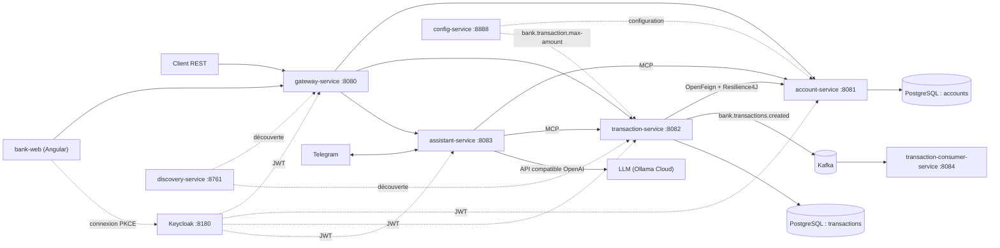
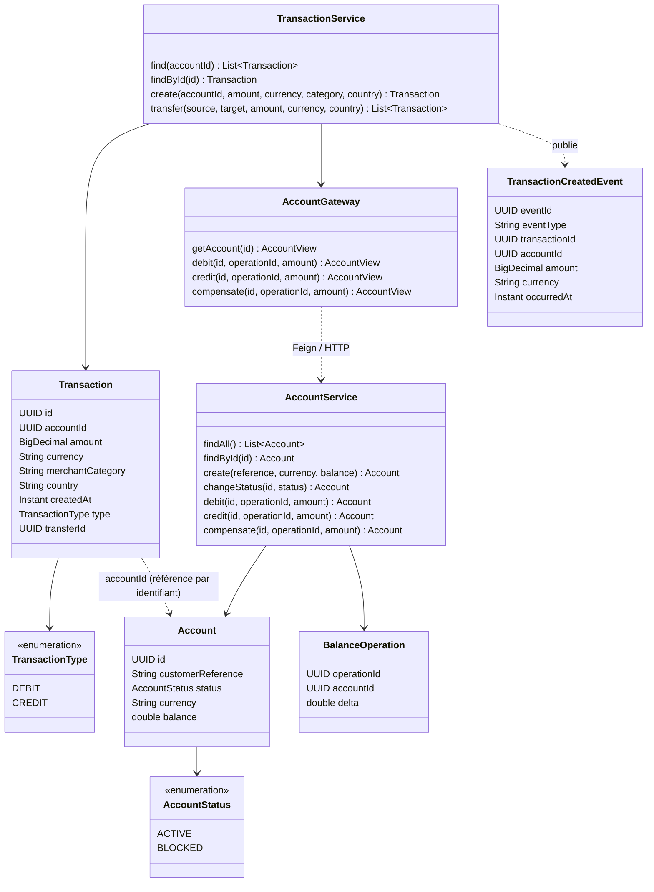
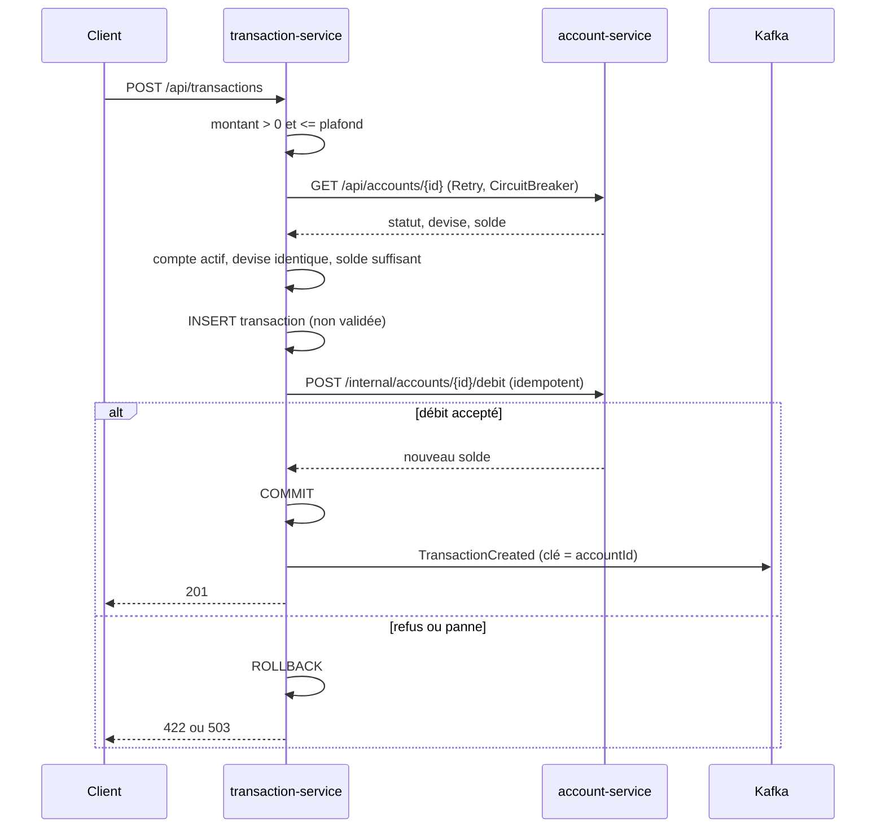

# Partie B : conception et architecture

## Schéma d'architecture

## Diagramme de classes

`AccountController`, `AccountGraphqlController` et `AccountMcpTools` appellent tous `AccountService`.
`TransactionController`, `TransactionGraphqlController` et `TransactionMcpTools` appellent tous `TransactionService`.

## Flux d'une nouvelle transaction

